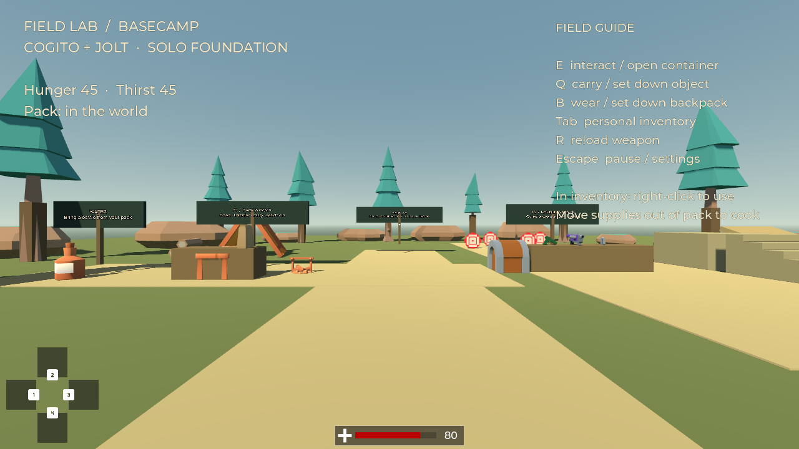

# Field Lab: backpacking sandbox

A playable Godot sandbox built on **COGITO 1.1.6**, Godot's **Jolt physics**, and **Kenney CC0** camp assets. Open `project.godot` in **Godot 4.6.3** and press **F6 on fieldlab/scenes/basecamp.tscn**, or simply **F5**.

This is a **solo foundation evaluation**, not the finished co-op game. The original custom prototype, including multiplayer, is preserved as a separate project under [legacy](legacy/README.md).

## Try the camp

- **WASD** move, **Shift** sprint, **Space** jump, **C** crouch.
- **E** interact/open, **Q** carry/set down, **B** wear/set down the backpack.
- **Tab** inventory; right-click items to use/equip. Native UI supports dragging and rotating items.
- **Left mouse** fire, **right mouse** aim, **R** reload.
- **Escape** pause/settings. Controls are rebindable; the on-screen field guide lists defaults.

At the left bench, open the expedition pack and move water, fuel and a meal into personal inventory. Open the stove: hydrate the meal, attach fuel, load the meal, ignite, wait ten seconds, extinguish, take the meal, then use it in inventory. Water and remaining fuel stay on the same item resources when transferred. Refill your bottle at the water station.

At the right bench, collect the existing COGITO foam pistol or laser rifle. Equip from inventory, take ammunition from the range chest, and shoot the destructible targets. Stairs, a ramp, and physics boxes are alongside the range.

## What is reused

COGITO provides the first-person controller, stairs handling, grid inventory and UI, interaction prompts, carrying, weapons/animations/reloads, settings and audio. Jolt provides physical simulation. Our small integration layer assembles the camp and adds backpack wearing, hydration and cooking. See [foundation notes](docs/FOUNDATION.md) and [third-party credits](THIRD_PARTY.md).

## Scope and testing

Run `./tools/test.sh` for integration checks in the actual Godot scene. Run `cd legacy && ./tools/test.sh` for the original prototype's domain, physics, settings and five-process multiplayer checks.

For rendered inspection: `godot --path . -- --capture` saves camp and inventory screenshots in `/tmp/fieldlab-captures` (override with `FIELDLAB_CAPTURE_DIR`). Requires a display.

Current boundaries: no co-op or save/load in the new camp; supplies transfer through inventories but cannot yet drop individually into the world; weapons use COGITO's existing ammo model, not persistent magazines/chambers. Backpack quick-access slots, detailed placement and a multiplayer authority layer remain future integration work. Wearing hides the pack; set it down to access it. Hunger/thirst are demonstration meters, not a tuned survival simulation.
